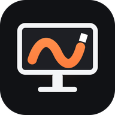
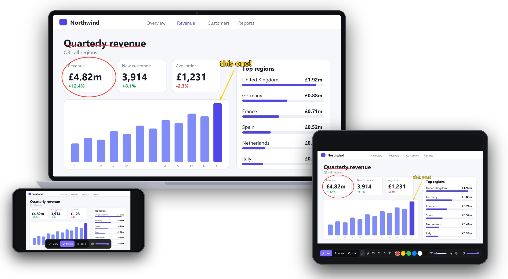
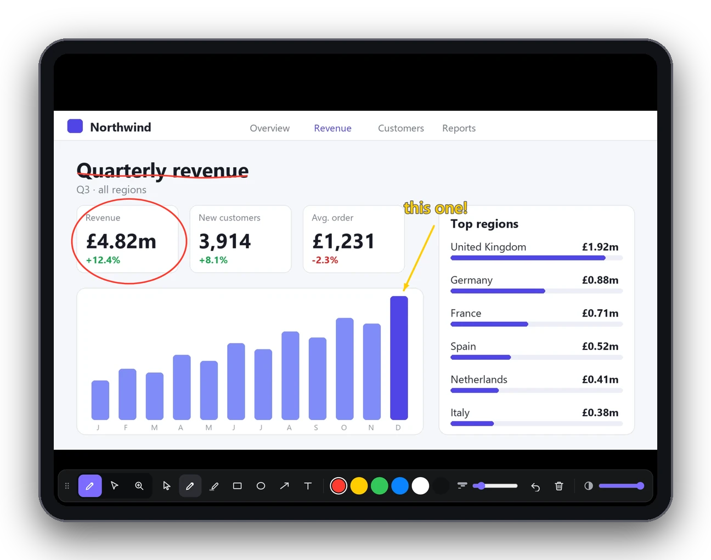
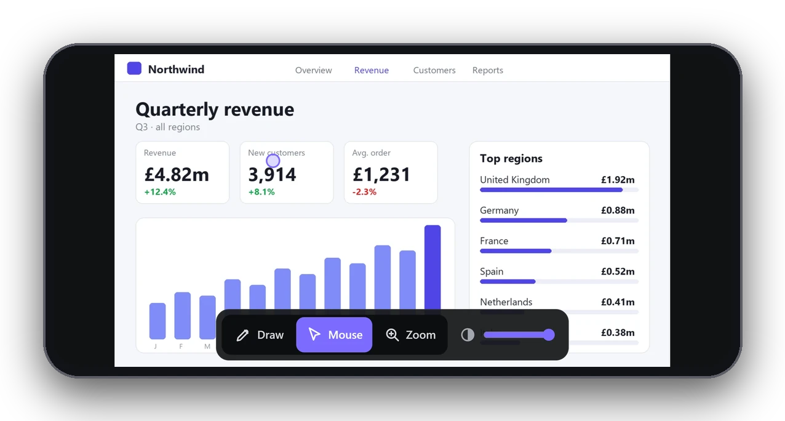
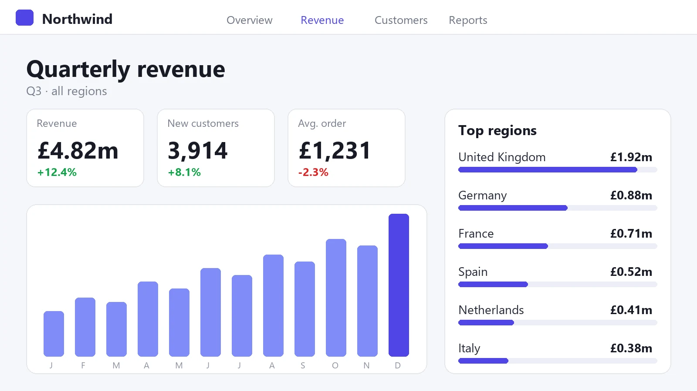

<p align="center"></p>

<h1 align="center">Screen Markup</h1>
<p align="center"><b>Draw on your phone or tablet and see it live on your PC screen.</b><br>
Turn any iPhone, iPad, Android phone or tablet into a wireless drawing pad and mouse for your Windows PC. No pen tablet, no cables, nothing to install on the phone.</p>

<p align="center">
<a href="https://github.com/rsw-digital/screen-markup/releases/latest"><b>⬇ Download for Windows</b></a> ·
<a href="https://screenmarkup.com">screenmarkup.com</a> ·
Free 7-day trial
</p>



## Why Screen Markup?
Need to circle, underline, sketch or explain something on your PC screen? Use the touchscreen you already own. Open Screen Markup on the PC, type the six-character code into your phone or tablet's browser, and draw. Your ink appears over whatever is on your screen – slides, a browser, a spreadsheet, a game or a video call – instantly.

## Features
- ✏️ **Draw over any screen** – ink appears live on top of any app on your Windows PC.
- 📱 **Phone & tablet drawing pad** – iPhone, iPad, Android phone or Android tablet. Finger or stylus.
- 👀 **Live view** – see your PC screen on your phone or tablet while you draw.
- 🖊️ **Smooth ink** – responsive, natural strokes.
- 🖱️ **Mouse mode** – use your phone or tablet as a wireless touchpad to control the PC.
- 🌍 **Any network** – the PC and phone don't need the same Wi‑Fi; mobile data works too.
- 👆 **Click-through** – keep using your PC normally while your drawing stays on top.
- 🌫️ **Fade the view** – fade or clear your drawing in a tap.
- 🔒 **Private by design** – only devices with your code can connect; screen and input travel through an encrypted relay and nothing is saved.
- 🚫 **Nothing to install on the phone** – it runs in the browser; add it to the home screen for full screen.
- ⚡ **Connected in under a minute** – open, enter code, draw.
- 🌐 **8 languages** – English, Spanish, French, German, Italian, Portuguese, Dutch and Japanese.
- ✅ **Signed installer** – code-signed by RSW Digital Ltd; per-user install, no admin rights needed.

| Draw from your tablet | Control the mouse |
|---|---|
|  |  |



## Perfect for
- **Teaching & online tutoring** – write maths, label diagrams and mark up worksheets on a shared screen, like a digital whiteboard.
- **Presenting** – highlight key points on slides and dashboards while you walk the room.
- **Streaming & recording** – sketch on screen live in OBS, YouTube or Twitch, and in tutorial videos.
- **Video calls** – share your screen in Zoom, Teams or Meet and draw so everyone sees it.
- **Design review & feedback** – circle issues on mock-ups, websites and documents during reviews.
- **Remote support** – point to exactly where to click.

## Install
**winget**
```powershell
winget install RSWDigital.ScreenMarkup
```
**Scoop**
```powershell
scoop bucket add rsw-digital https://github.com/rsw-digital/scoop-bucket
scoop install rsw-digital/screenmarkup
```
**Chocolatey**
```powershell
choco install screenmarkup
```
**Direct download:** [ScreenMarkupSetup.exe (v0.3.16)](https://github.com/rsw-digital/screen-markup/releases/download/v0.3.16/ScreenMarkupSetup.exe) · SHA256 `40D87BF63A53B723EF763B10FFC30D64FB7E240404B091CA79808CB5DFAE595E`

> Package-manager listings are rolling out; if one isn't live yet, use the direct download.

## Requirements
- Windows 10 or 11 (x64), main monitor
- Any phone or tablet with a modern browser

## Pricing
Free 7-day trial, then £10 a year or £25 for life (plus VAT). See [screenmarkup.com](https://screenmarkup.com/#pricing).

## How it works
1. Open Screen Markup on the PC. It shows a code.
2. Enter the code on your phone or tablet.
3. Draw. It appears on the PC at once.

## Support
[screenmarkup.com/support](https://screenmarkup.com/support/) · [Privacy](https://screenmarkup.com/privacy/) · [Terms](https://screenmarkup.com/terms/)

---
Screen Markup is commercial software by **RSW Digital Ltd**. This repository hosts the official releases and listing.

<sub>Keywords: draw on screen, screen drawing app, use tablet as drawing pad for PC, phone as drawing tablet, iPad as drawing tablet for Windows, Android tablet drawing pad, on-screen annotation, digital whiteboard, screen marker, presentation drawing tool, online teaching tool.</sub>
